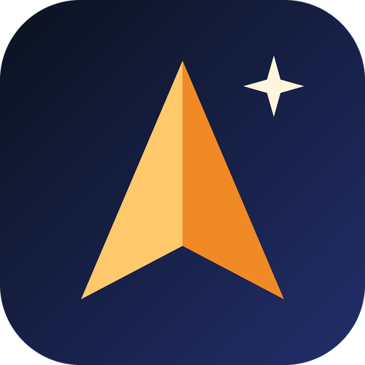

# Atlas

### An offline AI, library and field guide for your phone or tablet

**For emergencies, travel and life off the grid, for becoming an expert at anything, and for a private assistant you can talk to. Everything runs on the device. No internet needed once it is set up.**

[**Download the latest Android app (APK)**](https://github.com/coolchan03/Atlas/releases/latest)

---

## Install

1. On your Android phone or tablet, open the [latest release](https://github.com/coolchan03/Atlas/releases/latest) and download the `Atlas-<number>.apk` file.
2. Open it and allow installing from this source when Android asks. New versions install over the old one and keep your chats and settings.
3. Open **Models** and download a text model (a small one like Qwen or Gemma 1-4B runs well on most phones). Do this on Wi-Fi.
4. Optional, while you still have internet: download a natural voice (**Models → Voice**), the Atlas library packs and offline encyclopedias (**Settings → Offline Library**), and a map of your area (**Atlas → Maps**).

After that, airplane mode is fine.

## What it does

### Atlas: emergencies, travel and off-grid life
Open **Atlas** from the Agents tab or Settings.
- **Emergency cards** – bleeding, CPR, choking, burns, broken bones, heat stroke, severe allergic reactions, snakebite, cold, dehydration, infected wounds, safe water, phone power, getting found when lost, making fire. Big text, can be read aloud.
- **Survival Manual** – the full open Survival Manual (water, fire, shelter, food, plants, navigation, first aid) with pictures, search and your own notes.
- **Offline maps** – download your state or country once (OpenStreetMap data), then the map, your GPS position and saved places (camp, car, water) with distance and direction all work with no signal.
- **Phrases** – emergency and travel phrases in many languages, shown large or spoken aloud, plus translate anything with the AI.
- **Compass** – appears only if your device has a compass sensor.
- **Off-grid mode** – one switch: Atlas agent on, internet tools off, low-battery mode on. Optional red night screens.
- **Offline Library** – the Atlas library (hundreds of free medical, water, farming, engineering and survival manuals, turned into searchable text) and optional Kiwix encyclopedias such as WikiMed, Wikipedia, Wikivoyage and iFixit. The AI can search and quote them.

### Agents and projects
- **Agents** decide who answers and how: each has its own instructions, model, temperature, context length and tools. Built-in agents include Atlas (survival/medical), Field ID (plants and animals from a photo, with an EDIBLE / POISONOUS / NOT SURE verdict and lookalikes), Phone Assistant (files, calendar, web pages), Writer and Talk.
- **Projects** hold your chats and documents. Each project can have its own instructions and knowledge base.
- **Chats** can have their own instructions, can be **private** (never saved), and long chats are **compressed automatically** so they can keep going.
- **Ask other agents** – the Assistant can put a question to the agent who knows the subject (Home Chef, Accountant, Repair Helper, Paperwork Reader, Atlas, or an agent you made) and pass the answer on. It asks you first every time, and the other agent sees only that question. It can also hand the whole chat over to that agent. Turn it off for any agent in its editor.
- **Tools** – web search (DuckDuckGo, SearXNG, Exa, Parallel, Tavily and more, never in off-grid mode), offline library search, files, calendar, "my location", memory.

### Learning mode (make an agent an expert)
Give an agent a task. A **learner** writes a bank of study questions, a **judge** approves or rejects them (the learner can argue back), the learner researches each question and writes short reports, the judge checks every report for logic and sources, and every so often a **manager** reviews both against the original task and steers them back on course. Choose **Keep learning** (lessons and checked answers are saved into the agent and project) or a temporary **Practice session**. You can use a different model for each role.

### Roundtable
Roles take turns on your phone's model, each under its own persona, and you join in where the format asks you to. Open **Roundtable** from the Atlas hub or search.
- **Debate** – two sides argue and answer each other, and a judge names the winner and the best argument on each side.
- **Writers' room** – an optimist, a skeptic and a specialist work a problem while a moderator keeps it moving and closes with what they agree on.
- **Red team** – one role defends your plan, another attacks it, and an auditor lists the top five remaining risks with a fix for each.
- **Critique and revise** – a writer drafts, a critic marks it up, and the loop ends when the critic passes it.
- **Tutor, student and quiz** – a tutor teaches, a student asks the beginner questions, then an examiner quizzes you.
- **Game master, Mystery** – a narrator runs a story you play. A hidden referee keeps the place, your pack and the facts of the case, so the story stays consistent. With an image model chosen, **Draw each scene** paints a picture under each scene.
- **Language role-play** – practice a real situation in another language while a coach corrects each message.
- **Interview** – the app asks about a memory or a person, one question at a time, then writes the story using only what you said.
- **Lesson for a child** – a short story at the child's age, then a gentle quiz.

Every role keeps its own voice when you press Listen (a fourth speaker, as in the writers' room, is the first voice at a higher pitch). A finished session can become an audio episode in the podcast player, and every session is saved so a game can be continued. Long sessions stay inside a small model's memory because older turns are folded into a short summary.

### Photo studio
Three things to do with one photo, from the Atlas hub or search. It needs a model with a vision file (the eye icon in My models).
- **Narrator** – point at anything and hear it described as a nature documentary, a sports commentary, a calm guide or a museum guide. It describes only what is in the picture.
- **Time machine** – the same place 50 or 100 years ago, or 50 or 100 years ahead: a short passage, and a picture in the look of the era when an image model is chosen. The future ones say they are imagined.
- **Sketch to picture** – photograph a drawing, and Atlas describes it and paints a finished picture from the description, as a watercolour, a photograph, a cartoon or an oil painting. It re-imagines the sketch; it does not trace the lines.

### Study mode (like NotebookLM, offline)
Pick a project and get a study guide, flashcards, a quiz, a mind map, an answer to a question, a narrated slideshow, or a **podcast episode**. Pick a format (two friends, lecture, entertaining, deep dive, debate, interview, story or for beginners) and any length from 2 to 90 minutes; the screen shows how many parts that is and about how long it takes to write on your phone. A lecture and a story use one narrator, the others use the number of hosts you choose when more than one voice is installed. Extra research is optional. The same options are in **Learn a topic**: Make a podcast from this course turns the lessons already written into an episode. Every item links back to the exact passage it came from. Players show the time and let you skip and seek.

### Voice
- Read answers aloud, talk by voice, and **hands-free mode** for a back-and-forth like a phone call (speech-to-text with Whisper).
- **Read aloud** – paste text or open a document and have it read to you in any installed voice (add the Read text aloud widget to Home for quick access). Play, pause, skip by part and change the speed.
- **Natural voices** – human-sounding neural voices (Kokoro with 11 voices, and Piper voices) that run on the device.

### Also
Image generation, vision models, models on a computer on your Wi-Fi (Ollama, LM Studio), backup and restore, low-battery mode, and layouts for phones, foldables and large tablets.

## Privacy
Chats, documents, notes, locations and voice stay on your device. The internet is only used when you download something or use a web tool, and off-grid mode turns web tools off completely.

## For builders
- The Android app is built by GitHub Actions (`.github/workflows/atlas-apk.yml`) on every change and published as a release.
- The Atlas library is built by `.github/workflows/atlas-packs.yml` from `atlas/atlas_all.py`: it downloads free public documents, converts them to text (with OCR for scans) and publishes one pack per subject on the `atlas-library` release. The same script can also build the library on a Windows PC.
- Natural voices are repackaged by `.github/workflows/atlas-voices.yml` onto the `atlas-voices` release.

## Credits and license
MIT licensed (see [LICENSE](LICENSE)). Built on the open-source Off Grid app, [llama.cpp](https://github.com/ggerganov/llama.cpp), [whisper.cpp](https://github.com/ggerganov/whisper.cpp), [sherpa-onnx](https://github.com/k2-fsa/sherpa-onnx), [Kiwix](https://www.kiwix.org), [Mapsforge](https://github.com/mapsforge/mapsforge) with OpenStreetMap data, and the [Survival Manual](https://github.com/ligi/SurvivalManual). Library documents belong to their publishers and are free public resources.

**Medical content is general guidance, not a doctor. Get professional care whenever you can.**
